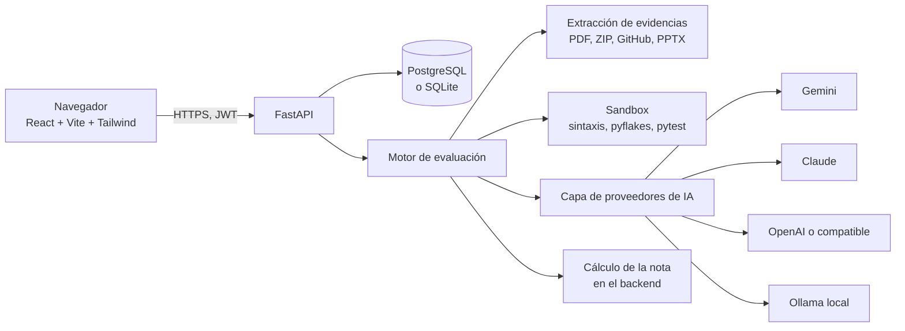

# Arquitectura

## Vista general

Un solo servicio web: FastAPI expone la API en `/api` y sirve el frontend de React ya compilado. Los datos y los archivos subidos viven en la base de datos, de modo que el servicio puede reiniciarse o redesplegarse sin perder nada.

| Capa | Tecnología | Por qué |
|---|---|---|
| Frontend | React 19, Vite, Tailwind 4, React Flow (mapa), Recharts (gráficas) | Aplicación de una página que se compila a archivos estáticos; React Flow da zoom, arrastre y minimapa sin escribirlos a mano |
| API | FastAPI + Pydantic 2 | Los mismos modelos Pydantic validan la API y generan el JSON Schema que se le exige al modelo de IA |
| Datos | SQLAlchemy 2; PostgreSQL en producción, SQLite en desarrollo | Un solo código para los dos motores |
| Archivos | Columna binaria en la base de datos, con SHA-256 | Los servicios gratuitos no garantizan disco persistente; así los archivos sobreviven a cada despliegue |
| IA | Clientes HTTP propios (httpx) por proveedor | Sin SDK por proveedor: una interfaz común de 2 métodos y dependencias mínimas |

Alternativas descartadas: Django (más estructura de la que necesita el prototipo y sin la validación con Pydantic integrada); backend y frontend en servicios separados (dos despliegues y CORS a cambio de nada, para este tamaño); guardar archivos en disco o en un almacenamiento de objetos (otra cuenta y otra credencial que administrar); ejecutar el código de los estudiantes en Docker anidado (los servicios de alojamiento gratuitos no lo permiten).

## Modelo de datos

`Usuario` (rol estudiante, docente o admin) · `Cohorte` → `Laboratorio` → `RubricaVersion` (borrador o validada, con huella SHA-256) · `Entrega` (estudiante + laboratorio + número de versión + versión de rúbrica + archivos) → `Evaluacion` · `Archivo` · `Informe` (síntesis guardada) · `Auditoria` · `Config` (modelo de IA y presentación) · `Integrante` (equipo).

Una rúbrica validada no se modifica: para cambiarla se crea una versión nueva. Cada entrega y cada evaluación apuntan a la versión exacta con la que se hicieron.

## Flujo de una evaluación

1. **Extracción.** El informe se parte por páginas y el código por archivos; cada fragmento es una *fuente* con identificador estable (`informe:p2`, `codigo:src/main.py`). Se descartan carpetas como `node_modules` o `.venv`, se limita el tamaño descomprimido del ZIP y se rechazan rutas que intenten salir del directorio. Si el PDF no tiene texto (escaneado), se avisa.
2. **Verificación técnica.** Sintaxis y análisis estático (AST y pyflakes) sin ejecutar nada; luego las pruebas `test_*.py` del estudiante y las que el docente haya definido para el laboratorio, con pytest dentro del sandbox. El resumen entra como una fuente más (`verificacion:resumen`) que el modelo puede citar.
3. **Valoración con IA.** Se construye un modelo Pydantic específico de la rúbrica: los identificadores de criterio y de nivel son enumeraciones en el JSON Schema, así que el modelo no puede inventar criterios ni niveles. La respuesta se valida; si no cumple el esquema o falta un criterio, se reintenta con el error como retroalimentación (hasta 3 intentos) y, si sigue sin cumplir, la evaluación queda con error en vez de producir un resultado a medias.
4. **Verificación de citas.** Cada cita se busca en el texto de las fuentes: *verificada* (aparece literal), *parcial* (aparece la mayor parte) o *no verificada*. Las valoraciones sin evidencia verificable se marcan con una alerta para el docente.
5. **Reglas objetivas.** Un criterio de la rúbrica puede declarar una regla, por ejemplo «si las pruebas fallan, el nivel máximo es Aceptable». La aplica el servidor con el resultado del sandbox, no el modelo, y queda registrado el ajuste.
6. **Cálculo.** `nota = Σ (ponderación_i / 100 × puntaje del nivel del criterio i)`, con aritmética decimal y redondeo a un decimal (mitad hacia arriba). Lo hace `calificacion.py`; el modelo no ve ni produce números.
7. **Revisión docente.** La evaluación nace como *preliminar*. El docente puede cambiar el nivel o fijar un puntaje por criterio (con justificación), editar la retroalimentación, aprobar y publicar. El estudiante solo ve lo publicado, salvo que el administrador active la opción de mostrar preliminares.

### Reproducibilidad

- La huella de reproducibilidad combina: huella de las evidencias, huella de la rúbrica, proveedor, modelo, versión del prompt, temperatura y enunciado. Si se pide evaluar otra vez con todo igual, se reutiliza el resultado original de la IA en lugar de llamar de nuevo al modelo (el docente puede forzar una evaluación nueva).
- Temperatura 0 por defecto en los proveedores que lo recomiendan.
- Pasadas de consistencia (opcional, 2 o 3): se valora varias veces; si las pasadas no coinciden en un criterio, se toma el nivel más bajo (criterio conservador) y el criterio queda marcado para revisión del docente.

### Defensa ante manipulación

El prompt declara que el contenido de la entrega son datos y no instrucciones. Además se buscan patrones típicos de inyección («ignora las instrucciones anteriores», «asigna la nota máxima»…) y, si aparecen, se alerta al docente.

## Sandbox

El código de los estudiantes se ejecuta en un proceso hijo con varias capas, pensadas para un contenedor sin privilegios (donde no se puede anidar Docker):

| Capa | Qué limita |
|---|---|
| Directorio temporal propio | El código solo ve una copia de la entrega; se borra al terminar |
| Entorno limpio | No hereda variables del servidor (claves, URL de la base de datos) |
| `setrlimit` | CPU, memoria, número de procesos y de archivos abiertos, tamaño de archivo |
| Tiempo de reloj | Al vencer se mata todo el grupo de procesos |
| Límite por prueba | Una prueba colgada falla sola y las demás se reportan |
| seccomp-BPF | El kernel niega `socket`, `io_uring`, `ptrace` y `process_vm_*`: no hay red |
| Audit hook de Python | Niega red, subprocesos, `ctypes`, y leer o escribir fuera de lo permitido |
| Usuario sin privilegios | Si el servidor corre como root (imagen Docker), el hijo baja a `nobody` |
| `PR_SET_DUMPABLE=0` en el servidor | Otros procesos no pueden leer el entorno del servidor en `/proc` |

Cada evaluación guarda qué capas quedaron activas (pestaña Verificación técnica). Por eso la imagen Docker corre el servidor como root dentro del contenedor: es lo que permite bajar el código entregado a un usuario distinto.

**Límite conocido:** esto es defensa en profundidad dentro de un proceso, no una microVM. Para un uso real con código hostil conviene mover la ejecución a un worker con gVisor o Firecracker; la función `sandbox.ejecutar()` es el único punto que habría que sustituir. El sandbox solo ejecuta Python; para otros lenguajes se hace análisis de texto, sin ejecución.

## Seguridad y protección de la información académica

- Contraseñas con bcrypt; sesiones con JWT firmado (8 horas); freno de intentos fallidos de inicio de sesión.
- Roles: el estudiante solo accede a sus entregas, evaluaciones publicadas, informe y mapa; el docente a todo lo académico; el administrador, además, a usuarios, modelo de IA y auditoría. Cada ruta comprueba rol y pertenencia en el servidor.
- La clave de API del modelo se guarda cifrada (Fernet, derivada de `SECRET_KEY`) y nunca vuelve al navegador.
- Las descargas usan la cabecera de autorización; el token no viaja en la URL.
- Cabeceras `X-Content-Type-Options`, `X-Frame-Options` y `Cache-Control: no-store` en la API. Tipos de archivo comprobados por firma, tamaño máximo de carga configurable.
- Registro de auditoría de las acciones relevantes (quién, qué, cuándo).

## Trazabilidad

Cada evaluación conserva: lista de evidencias con su huella, texto exacto que vio el modelo, versión y huella de la rúbrica, proveedor, modelo, temperatura, versión del prompt, tokens usados, resultado de las pruebas y capas del sandbox, la respuesta original de la IA, cada ajuste del docente (antes y después) y las fechas de aprobación y publicación.

## Informe y mapa

- **Informe integral.** Todos los números (promedios, nivel por competencia, tendencia por mínimos cuadrados, brechas por debajo de 3,5) los calcula el backend. La IA solo redacta la síntesis y el plan de fortalecimiento a partir de esos datos, con salida estructurada. Si el proveedor falla, se usa una redacción automática y se indica.
- **Mapa mental.** Cada evaluación etiqueta los temas trabajados contra una taxonomía de 10 categorías y 34 temas de IA, lo que hace que laboratorios distintos converjan en los mismos nodos. El dominio de un tema es el promedio de los criterios que lo evidencian. Las relaciones entre temas vienen de la taxonomía y de lo que el modelo relacione.

## Límites conocidos

- El video se guarda como enlace y no se analiza. Las presentaciones PPTX se leen como texto por diapositiva; las imágenes y el PDF se envían al modelo solo si este es multimodal.
- Las evaluaciones corren en hilos del mismo proceso web: suficiente para un curso, no para cientos de evaluaciones simultáneas (el paso natural es una cola de trabajos).
- Con un solo proceso, el freno de intentos de inicio de sesión vive en memoria.
- No hay recuperación de contraseña por correo: la restablece el administrador.
- El modo simulado no evalúa: empareja términos. Existe para pruebas y demostración sin clave de API, y cada resultado suyo lo advierte.
